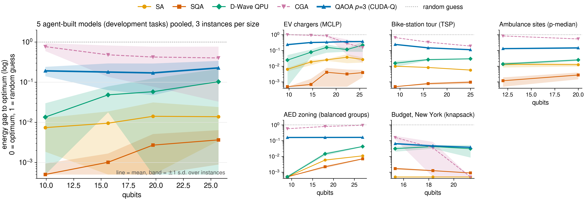

<div align="center">


**N**atural-language → **O**pen-data → **V**erified **A**gents for **Q**uantum

[](LICENSE)


Chia-Chen Yang<sup>1</sup>, Chia-Ho Ou<sup>1,2</sup><br>
<sup>1</sup>National Pingtung University, Taiwan · <sup>2</sup>Tohoku University, Japan

[Agent guide (繁體中文)](novaq/docs/agents_overview_zh.md)

</div>

---

## Contents

1. [Abstract](#abstract)
2. [Highlights](#highlights)
3. [Motivation](#motivation)
4. [A complete run, step by step](#a-complete-run-step-by-step)
5. [System design](#system-design)
6. [Verification design](#verification-design)
7. [Evaluation protocol](#evaluation-protocol)
8. [Results](#results)
9. [Hardware and software](#hardware-and-software)
10. [Limitations](#limitations)
11. [Installation and usage](#installation-and-usage)
12. [Repository structure](#repository-structure)
13. [Citation, license and acknowledgements](#citation)

---

## Abstract

Turning a real planning request into a QUBO requires finding and cleaning data, choosing a formulation and tuning
penalties: expertise that most users do not have. NOVA-Q takes a single sentence, such as *"place 3 EV chargers in
Da'an District, Taipei, to cover the most residents"*, and lets local LLM agents clarify the request, retrieve and
prepare official open data, formulate a QUBO, and solve it on simulated, quantum and GPU annealers and on QAOA with
NVIDIA CUDA-Q. Because LLM output can look right and still be wrong, every solve is surrounded by independent checks:
three gates before the solver and one after, run by checker agents that never see the work they check. A frozen
acceptance judge scores each delivery against ground truth built directly from the raw public files.

## Highlights

- **End to end on real cities.** 15 of 18 runs across Taipei, London, Melbourne and New York pass the independent
  judge, using official open data and local models only (no cloud LLM). On a held-out test set built after freezing
  the code (Singapore, Paris, Cambridge MA), 8 of 9 pass; on a second one run as independent samples (Basel, Dublin,
  Somerville), 4 of 9 pass. Every failure is documented run by run and fixed afterwards.
- **Verification that catches real faults.** Blind checker agents catch injected harmful faults 97/99 (data) and
  66/78 (model); no valid plan was wrongly rejected (300/300).
- **Same budget, a different rule.** On New York's 2017 participatory budget (Council District 3), the plan that
  maximises total votes funds 7,103 votes for the $1 M budget; the city's own rule, which funds projects in vote
  order, funds 5,381. The two rules pursue different goals; the point is that the delivered plan is the exact optimum
  of the objective the user stated.
- **Real requests solved end to end by QAOA on CUDA-Q.** New York's budget (25 qubits): 3 of 3 pass the judge, each
  with QAOA's own optimal sample; Cambridge's (26 qubits): 3 of 3 pass, 2.7% below the optimum; Somerville's
  (28 qubits): 2 of 2 pass, 4.7% below.
- **One verified model, six solvers.** On its QUBO: simulated annealing, simulated quantum annealing, the D-Wave
  Advantage QPU, a GPU annealer and QAOA on CUDA-Q, compared on 57 instances with known optima. On its MILP form:
  NVIDIA cuOpt, which proves the optimum of the agents' own models on 9 of 11 tasks.

## Motivation

Large language models can write a QUBO from a problem statement, but on real requests three things go wrong:

1. **The request is underspecified.** "Cover the most residents" leaves open the radius, whether a resident covered
   twice counts twice, and which administrative level the data use.
2. **The data are not ready.** Official tables mix periods, include subtotal rows, use area codes instead of names,
   store coordinates in local projections, or list one place several times.
3. **The model can be silently wrong.** A relaxed bound ("at most 200" instead of "exactly 5"), a flipped objective or
   a double-counted term still produces a QUBO that solves and returns a plausible answer.

Existing systems avoid these problems rather than detect them: they assume a correct intermediate model, learn from
test cases the user writes, check the translation only on standard textbook problems, or start from a hand-built model.
NOVA-Q targets the realistic setting (a vague sentence, raw public data, no user-written tests) and makes verification,
not generation, the central design element.

## A complete run, step by step

The New York participatory-budget task, as it ran in the evaluation (about 20–37 minutes per run on one L40S):

| Step | What happens | Output in this run |
|---|---|---|
| 1. Request | *"District 3's 2017 participatory budget is $1 M; choose the projects to fund, total cost at most $1 M, as many votes as possible. Use NYC Open Data."* | |
| 2. Clarifier | asks only questions that change the model; decides the rest as explicit assumptions the user confirms | asked about extra hard limits and dependencies between projects; assumed no category quotas and votes as the only value |
| 3. Modeler | writes a typed binary model: variables, objective, hard constraints, the data it needs, and a map from each user requirement to its constraints | one binary variable per project, one budget inequality (0-1 knapsack) |
| 4. Gate ② | a checker agent, given only the specification, writes its own evaluator; random valid plans must be feasible in the model and ranked alike, mutated plans must be infeasible | 20/20 valid plans kept, 13/13 over-budget plans rejected, rank agreement 1.0 |
| 5. Data search | searches a catalogue of 11 national portals and the open-data platform APIs; ranks candidates by their actual columns | `Participatory Budgeting Projects`, data.cityofnewyork.us |
| 6. Data agent | looks at the table with read-only tools, then writes a preparation plan made of tested steps | kept Vote Year 2017 and Council District 3: 15 projects |
| 7. Gates ① and ③ | the prepared data must match the declared units, period and area; a second checker recomputes counts and totals from the raw table | consistent |
| 8. Solve | the model is compiled to a QUBO (penalties and slack variables chosen and tuned by code) and solved | 7 projects, $980,000, 7,103 votes |
| 9. Gate ④ | the delivered plan is checked against the original constraints and compared with a simple baseline | feasible, equal to the baseline's best |
| 10. Judge ⑤ | the frozen judge compares data, model and delivery with ground truth enumerated from the raw file | pass (the exact optimum) |

If a gate fails, its evidence (which requirement, which plan, which numbers) goes back to the stage that can fix it:
the data agent for data problems and the Modeler for model problems. A repair may change the formulation but never the
confirmed requirements, the objective direction or a user setting.

## System design

### Agents

| Agent | Role | Sees | Never sees |
|---|---|---|---|
| Clarifier | turns the request into a confirmed specification: decisions, objectives, hard and soft constraints, data scope, assumptions; may look up laws and standards on the web | the request, the user's answers | any formulation |
| Pattern retrieval | picks up to three general modelling patterns (e.g. cardinality, one-hot assignment, position-based tour, coverage counted once) | the specification | |
| Modeler | writes the binary model, the data schema and the requirement map | the specification, the patterns | the data checker |
| Requirement checker (gate ②) | writes an independent evaluator and a sampler of valid plans | the specification, the data schema | the model |
| Data scout | proposes searches; the system runs them and downloads candidates | the specification, the data schema | |
| Data agent | explores the tables, then writes a preparation plan from tested tools | table profiles, tool results | |
| Data checker (gate ③) | recomputes expected counts and totals from the raw tables | the specification, the raw tables | the preparation plan |
| Acceptance judge (gate ⑤) | scores data, model and delivery against ground truth | the system's outputs | is never seen by the system |

All agents run on local models served by vLLM. Doer and checker can be assigned to different model families.

### Open data

The data layer searches a pre-built catalogue of 11 national portals (Taiwan, Singapore, Japan, Australia, Ireland, UK, the
Netherlands, Berlin, Germany, Canada, Switzerland) plus CKAN, Socrata, Opendatasoft, ArcGIS, EU and Nomis APIs and
OpenStreetMap. Candidates are ranked by a preview of their real columns, official sources are preferred over
crowd-sourced ones, and the latest period of a dataset is kept.

Preparation is done by **tested tools, not free-form code**. The data agent first inspects columns, distinct values,
sample rows, key overlaps and which area code lies in which named area; then it writes a plan of steps such as
`latest_period`, `keep_category`, `keep_level`, `to_wgs84`, `in_area` (real boundaries), `within_radius`,
`merge_same_place`, `reduce_points` and `join`. Each step runs on the full table and its result is shown before the
next decision. Public values that are missing are reported as a data gap; they are never filled with defaults.
Table text is treated as untrusted input to the agents: values shown to a model are length-capped and stripped of
chat-template tokens and code fences, cells that read like instructions ("ignore the above", an agent's own answer
format) are flagged in the profile, and the profile says that everything from a table is data
(`prep/safety.py`).

### Why QUBO

The gates verify a solver-agnostic model. At the sizes used here a MILP solver finds the exact optimum, which serves as
the reference for the judge and the solver study. Compiling the verified model to a QUBO lets the same model run
unchanged on simulated, quantum and GPU annealers and on QAOA, so the quantum and GPU solvers are evaluated on exactly
the problem the user asked for.

### Why QAOA, when the annealers do better

At these sizes simulated and simulated-quantum annealing reach lower energies than QAOA (median gap 0.007 and 0.001
against 0.16 over 57 instances), and the end-to-end benchmark runs deliver with SA. QAOA is not presented as the
faster solver. It is the gate-model path: the pipeline produces real-data, agent-built instances with known optima on
which QAOA can be tracked as circuit depth and qubit counts grow, and the New York budget shows that a verified model
runs end to end on QAOA at 25 qubits.

### From model to QUBO

The Modeler describes only variables, objective and hard constraints. Code compiles them into a QUBO: equality and
inequality constraints become penalty terms with binary or unary slack encodings, implications and exclusions become
pairwise terms, and penalty weights are chosen and tuned by the solver loop rather than by the LLM. The same compiled
QUBO is passed unchanged to every solver.

### Solvers

| Solver | Implementation |
|---|---|
| SA | dwave-samplers simulated annealing, followed by constraint-preserving exchange moves |
| SQA | OpenJij simulated quantum annealing |
| D-Wave QPU | D-Wave Advantage, 1,000 reads |
| GPU annealer (CGA) | a commercial GPU annealing service behind a Socket.IO server |
| Fujitsu Digital Annealer | v3c, REST, 300 DA-minutes per month; supported by the pipeline (`backends.py`), not part of the 57-instance study |
| QAOA | CUDA-Q 0.14 on the `nvidia` state-vector target, p = 3, COBYLA, 3 restarts, 10,000 shots; `nvidia-mqpu` for parallel evaluations |

## Verification design

Three principles guide the gates:

- **Independence.** A checker never sees the artefact it checks. The requirement checker writes its own evaluator
  from the specification alone; the data checker recomputes the expected data from the raw tables alone.
- **Agreement, not authority.** A disagreement is evidence, not a verdict: the checker can be wrong too. The evidence
  is returned to the stage that can fix it, and the repaired version must pass all gates again.
- **Diversity, measured.** On injected data faults a checker from a different model family catches more (98% versus
  73%); in full end-to-end runs it did not raise the pass rate (see the gate ablation), so one family is used.

The fault-injection study inserts harmful faults one at a time into otherwise correct runs: missing or duplicated
entities, swapped coordinates, values off by a factor of 10, total rows mixed in, points outside the area, dropped
constraints, flipped objectives, dropped pairwise terms, counts off by one and blocked entities.

## Evaluation protocol

- **Tasks.** Each task is a one-sentence request with fixed answers to the Clarifier's questions, so runs are
  comparable. Every run starts empty: no cached model, data or LLM answers.
- **Ground truth.** Built by hand-written code directly from the official raw files, before the runs, and never visible
  to the system.
- **Pass criteria.** A run passes only if all three hold:
  1. *data*: every entity maps one-to-one to a real entity, nothing is missing or duplicated, coordinates and measured
     values match;
  2. *model*: 30 random valid plans are feasible and rank like the true metric (Spearman ≥ 0.9), and invalid plans are
     infeasible;
  3. *delivery*: the plan satisfies the original request and is within 10% of a reference computed from the raw data.
- **Repeats.** Three runs per task; the first three finished runs count. Stop rules are written down before a batch
  starts ([acceptance/PREREGISTRATION.md](novaq/acceptance/PREREGISTRATION.md)).
- **Held-out test set.** The pipeline code is frozen (hash recorded) before the reference answers of new tasks are
  built, and is not changed while they run.

## Results

### Real cities, official open data

Three runs per task; Gemma-4-31B-it as doer and checker; simulated annealing as the solver. One end-to-end run takes a
median of 44 min (17–85 min) and about 110k LLM tokens, all on the two local L40S GPUs. Pass rates with 95% Wilson
intervals: 15/18 (61–94%), test set 1 8/9 (56–98%), test set 2 4/9 (19–73%).

| City and task | Problem type | Official source | Instance | Passed |
|---|---|---|---|:---:|
| Taipei: EV chargers | maximum coverage | village census | 53 villages, 0.28 M residents | 3/3 |
| Taipei: bike-station tour | travelling salesman | YouBike live API | 18 stations | 2/3 |
| Taipei: AED inspection zones | balanced partition | AED registry | 48 sites | 3/3 |
| London: ambulance stations | p-median | ONS Census 2021 | 27 areas, 0.21 M residents | 1/3 |
| Melbourne: bike-station tour | travelling salesman | City of Melbourne dock registry | 11 docks | 3/3 |
| New York: participatory budget | knapsack | NYC Open Data ballot results | 15 projects, $1 M | 3/3 |
| **Total** | | | | **15/18** |

With a Qwen3.6-35B-A3B doer, the first four tasks pass 5/12. The Melbourne and New York rows and the test set ran
with the revised agent prompts of 2026-10-21; the other rows with the earlier version. One Melbourne pass followed an
automatic repair that changed the formulas without human review (such deliveries are now flagged
`review_required`).

### Held-out test set

The pipeline code was frozen (hash recorded) before the reference answers of three new tasks were built, and was not
changed while they ran. Same configuration as above; the first three finished runs per task count.

| City and task | Problem type | Official source | Instance | Passed |
|---|---|---|---|:---:|
| Singapore: hawker-centre zones | balanced partition | data.gov.sg Hawker Centres | 12 centres, 3 zones | 2/3 |
| Paris: Vélib' station tour | travelling salesman | opendata.paris.fr | 10 stations | 3/3 |
| Cambridge, MA: participatory budget | knapsack | data.cambridgema.gov ballot | 16 projects, $525k | 3/3 |
| **Total** | | | | **8/9** |

The failed run found no official source and fell back to OpenStreetMap food courts (49 places instead of 12 hawker
centres); the judge caught it. All three Cambridge runs return the exact optimum (24,769 votes, versus 22,004 under the
vote-order rule). Run-by-run notes: [results/e2e_test_RESULTS.md](novaq/results/e2e_test_RESULTS.md).

### Second held-out test set

Built and run the same way (code frozen at hash `e9f33f6315f8db90` before the reference answers were built), with one
difference: every agent samples at temperature 0.7, so the three runs of a task are independent.

| City and task | Problem type | Official source | Instance | Passed |
|---|---|---|---|:---:|
| Basel: AED inspection groups | balanced partition | opendata.swiss Defibrillatoren | 35 places, 5 groups | 0/3 |
| Dublin: Dublinbikes station tour | travelling salesman | data.gov.ie | 9 stations | 2/3 |
| Somerville, MA: participatory budget | knapsack | data.somervillema.gov | 20 proposals, $1 M | 2/3 |
| **Total** | | | | **4/9** |

The five failures have four causes, all in the pipeline rather than the solver: rows with the same place name but
more than 150 m apart were not merged although the request said one name is one place (Basel, twice); model
validation shrank its example to an empty instance and reported correct constraints as missing (Basel); a portal's
internal row id became the proposal name (Somerville); and the Clarifier turned the landmark that only defines the
area into the tour's start, against the user's answer (Dublin). Each is fixed generically after the test (name-only
merging, validation on the full example, no portal row ids, a check of the draft against the user's answers, and the
data cross-check now also covers data the model labels private). Post-fix runs, reported apart and not counted:
Dublin 2/2, Somerville 2/2, and Basel 3/3 on the latest code, after three more generic fixes found on the way
(GeoJSON inside zip archives, the user's own words passed to the data agents, exchange moves through inequality rows)
(`novaq/results/e2e_postfix2_SETTINGS.md`). Run-by-run notes: [results/e2e_test2_RESULTS.md](novaq/results/e2e_test2_RESULTS.md).

### Gate ablation and a second-family checker

On the six tasks of test sets 1 and 2, with the code frozen before the runs (hash in each run's manifest.json; one run per task and arm,
`novaq/results/e2e_ablation_SETTINGS.md`):

| Arm | Passed | Wrong deliveries |
|---|:---:|:---:|
| All gates and repair (Gemma doer and checker) | 6/6 | 0 |
| No checker agent, no repair | 6/6 | 0 |
| All gates, checker from a second family (Qwen3.6-27B) | 4/6 | 0 |

On the fixed code these tasks no longer produce wrong data or models, so the gates had nothing to stop: they cost
nothing in pass rate or time, but this ablation cannot show their benefit, which rests on the injected-fault study
below. A second-family checker did not help in full runs (one failure was a tool-argument bug, fixed since; in the
other the Qwen checker counted the same wrong 40 places as the doer), so the pipeline keeps one family.

### Verification gates

Injected harmful faults, 9–18 per type; doer Qwen3.6-35B-A3B, checker Gemma-4-31B-it.

| Gate | Data faults caught | Model faults caught |
|---|:---:|:---:|
| any gate | 97/99 | 66/78 |

No false rejections in 15 verified runs (300/300 valid decisions accepted).

### Solvers on the same verified QUBOs

57 instances from six agent-built models on real city data (five development tasks and Singapore's hawker zones
from test set 1; 3 instances per size, k-means on random 80% subsets of the real points;
budget: random subsets with the budget kept at the same share of total cost), 9–27 qubits, optimum known by full enumeration. The energy gap is
(E − E<sub>opt</sub>) / (Ē<sub>random</sub> − E<sub>opt</sub>): 0 is the optimum and 1 a random guess.

| Solver | SQA | SA | D-Wave QPU | QAOA p=3 (CUDA-Q) | GPU annealer |
|---|:---:|:---:|:---:|:---:|:---:|
| Median energy gap | 0.001 | 0.007 | 0.027 | 0.16 | 0.46 |
| P(optimum) per sample over a random guess (median) | 1.7×10⁴ | 8.4×10³ | 4.2×10³ | 1.3×10³ | 2.0×10³ |
| Instances where the optimum was sampled | 57/57 | 57/57 | 53/57 | 57/57 | 57/57 |

At these sizes a random guess with 10⁴ samples also hits the optimum of the smallest instances, so the second row says
little; the ratio to a random guess is the fairer measure. Sample budgets: SA, SQA and the QPU 10³ reads, QAOA 10⁴
shots, the GPU annealer 10 s; the gap is a mean over samples and does not reward a larger budget. QAOA here is a GPU
state-vector simulation on CUDA-Q (`nvidia` target), not quantum hardware. It trails the annealers, mainly because
penalty terms reduce its feasible fraction.

<p align="center">
  
</p>

### A real request solved end to end by QAOA on CUDA-Q

The New York budget task was rerun with the same pipeline and the solver switched to QAOA (CUDA-Q 0.14, `nvidia`
target, p = 2 as the pipeline default, 10,000 shots) on one L40S. The verified model compiles to a 25-qubit QUBO (the budget inequality is
divided by the gcd of its integer costs before slack encoding).

| Runs | Passed (judge) | Delivered plan | Came from |
|---|:---:|---|---|
| 3 | 3/3 | 7 projects, $980,000, 7,103 votes (the exact optimum) | QAOA's own best sample in every run, no classical polish |

About 77% of QAOA's 10,000 shots are feasible plans; the solve stage takes 130–140 s per run.
Settings and run notes: `novaq/results/e2e_nycqaoa_SETTINGS.md`.

The judged models of the other tasks that fit (30 qubits at most) were re-solved with the same QAOA loop, raw samples
only (`novaq/scripts/experiments/agent_models_qaoa.py`):

| Task | Qubits | Models | Passed (judge) | QAOA's best sample |
|---|:---:|:---:|:---:|---|
| Cambridge budget | 26 | 3 | 3/3 | 24,096 votes, 2.7% below the optimum (24,769); 88% of shots feasible |
| Somerville budget | 28 | 2 | 2/2 | 98,167 points, 4.7% below the optimum (103,058); 85% of shots feasible |

Every other task needs 57 to 756 qubits.

### NVIDIA cuOpt on the agents' own models

cuOpt does not take a QUBO, so every judged model was solved in its MILP form: the agent's verified IR (binary
variables, linear constraints, linear and quadratic objective) with each product x<sub>i</sub>x<sub>j</sub> replaced by
a continuous y<sub>ij</sub> under the standard linearisation (y ≤ x<sub>i</sub>, y ≤ x<sub>j</sub>, y ≥ x<sub>i</sub> + x<sub>j</sub> − 1).
The MILP has exactly the feasible set and objective of the agent's model, and cuOpt's answer is judged by the same
frozen judge. Time limit 60 s, 300 s for the two most quadratic models; cuOpt 26.10 on one L40S
(`novaq/scripts/experiments/agent_models_cuopt.py`).

| Task | Variables | Judged models | cuOpt (GPU) |
|---|:---:|:---:|---|
| Taipei EV chargers | 106 | 20 | proven optimum = SA's answer, 4–29 s |
| Taipei bike-station tour | 324 | 12 | time limit; at 300 s 10/12 equal SA's answer, 2 are 2.0% longer |
| Taipei AED zones | 144 | 8 | time limit; at 300 s 7/8 equal SA's answer, 1 is 0.9% higher |
| London ambulances | 756 | 3 | proven optimum = SA's answer, 1–4 s |
| Melbourne bike-station tour | 121 | 3 | proven optimum = SA's answer, 13–19 s |
| New York budget | 15 | 9 | proven optimum = SA's answer, 1–22 s |
| Singapore hawker-centre zones | 36 | 2 | proven optimum, **5.8% better than SA's delivery** (true metric), < 1 s |
| Paris Vélib' tour | 100 | 4 | proven optimum = SA's answer, 4 s |
| Cambridge budget | 16 | 3 | proven optimum = SA's answer, 13 s |
| Dublin bike-station tour | 81 | 2 | proven optimum = SA's answer, 1–2 s |
| Somerville budget | 20 | 2 | proven optimum = SA's answer, < 1 s |

SA's deliveries include a classical exchange polish; cuOpt's numbers are its own output. The linearised tour and
grouping models are hard for a MILP solver (thousands of products), which is where the annealers do well.

### NVIDIA cuOpt on the same instances, standard formulations

cuOpt does not take a QUBO. The same real-city instances (the entities and distances the judge uses) were written as
standard routing and MILP formulations and solved with NVIDIA cuOpt 26.10 on one L40S (routing for the tours, MILP for the
rest), and exactly with HiGHS MILP on the CPU. Script: `novaq/scripts/experiments/cuopt_compare.py`.

| Task | Size | cuOpt (GPU) | Exact (HiGHS, CPU) | Pipeline deliveries (SA on the QUBO) |
|---|---|---|---|---|
| Taipei bike-station tour | 18 stations | optimum, 5.8 s | 0.04 s | optimum |
| Melbourne bike-station tour | 11 docks | optimum, 4.2 s | 0.02 s | optimum |
| Paris Vélib' tour | 10 stations | optimum, 5.4 s | 0.03 s | optimum |
| New York budget | 15 projects | optimum, 20.0 s | 0.01 s | optimum |
| Cambridge budget | 16 projects | optimum, 12.5 s | 0.01 s | optimum |
| Taipei EV chargers (coverage) | 53 villages, k = 3 | optimum, 20.6 s | 0.01 s | optimum |
| London ambulances (p-median) | 27 areas, p = 3 | optimum, 10.2 s | 0.02 s | optimum |

**At city scale** (`novaq/scripts/experiments/cuopt_scale.py`, same time limit for GPU and CPU):

| Problem | Size | cuOpt (GPU) | CPU |
|---|---|---|---|
| Paris Vélib' tour | 50 / 100 / 200 / 400 / 800 stations | 13.1 / 25.4 / 50.7 / 100.3 / 214.5 km | nearest neighbour + 2-opt: 1.2–3.4% longer, but done in < 0.1 s (cuOpt used its full 10–80 s limit); exact MILP: no tour beyond 50 stations |
| p-median, Camden + Islington | 256 areas, p = 8 (≈66k binaries), 60 s | cost 3.38e8 | HiGHS: 3.90e8 (15% higher) |
| Max coverage, all Taipei villages | 456 villages, k = 5, 60 s | optimum, 25.5 s | HiGHS: optimum, < 0.1 s |

cuOpt confirms every delivered answer. At the small sizes a CPU MILP solver is faster: cuOpt's routing runs to its time
limit (5 s) and its MIP workspace used managed memory because the LLM servers occupy most of each GPU. At city scale
cuOpt finds shorter tours than the CPU heuristic and a 13% cheaper p-median than HiGHS in the same 60 s; on coverage
the CPU stays faster.

## Hardware and software

| Component | Setup |
|---|---|
| LLM agents | vLLM on 2 × NVIDIA L40S (48 GB), FP8 weights: Gemma-4-31B-it and Qwen3.6-35B-A3B (Apache-2.0); one server per GPU, 160k-token context |
| QAOA | CUDA-Q 0.14, `nvidia` state-vector target (cuStateVec); up to 32 qubits on one L40S |
| GPU vs CPU | QAOA cost evaluation at 21 qubits: 0.079 s on one L40S vs 31.5 s on the CPU (400×) |
| Multi-GPU | `nvidia-mqpu` on 2 GPUs: 1.65–1.94× QAOA throughput; `nvidia-mgpu` over PCIe was slower than one GPU |

Planned: H200 and B200 GPUs (33–34-qubit state vectors per GPU, `nvidia-mgpu` over NVLink), larger agent models and
constraint-preserving QAOA mixers.

## Limitations

- **Scale.** QAOA runs as a CUDA-Q state-vector simulation, which fixes the range at about 20–30 qubits on one L40S (32 at most); the solver comparison stops at 27 qubits so that optima are known. At these sizes a CPU MILP solver finds the optimum in milliseconds: the QAOA instances are a benchmark testbed built from real requests, not a claim of solver advantage.
- **No direct-LLM baseline.** The pre-registration defines R0 (a model that finds data, models and solves on its own, with the same solver access); the saved batches contain R1–R3 only, so the benefit of the whole pipeline over a plain agent is not measured.
- **Solver tuning was not equal.** In the 57-instance comparison one fixed QUBO (default penalty weights) is given to every solver; SQA's `beta` was tuned on 3 instances, the others use fixed constants (CGA exposes only its time limit). Penalty weights were not tuned per solver. `scripts/experiments/solver_tuning.py` implements the equal-budget protocol (solver parameters and penalty multiplier, separate tuning and evaluation instances, scored on the original objective); its results are not in this README yet.
- **Specification errors pass every gate.** The gates check the model against the confirmed specification, not the specification against what the user meant; the Dublin failure is of this kind. The Clarifier's answers are fixed in the evaluation, so ambiguous real requests are untested.
- **Live data.** Several tasks use live APIs (bike stations); a re-run sees different data. Hashes of the data snapshots are not recorded, and most saved batches have no `manifest.json` or `backend` field (`scripts/report_runs.py` lists them).
- **Thresholds.** Gate and data-layer constants (Spearman ≥ 0.9, 10% tolerance, 150 m merge radius, ...) are fixed without a sensitivity analysis; `docs/constants_inventory.md` lists them.
- **Larger instances.** City-scale versions of the tasks pass far less often; the main failures are in data
  preparation.
- **Repeats.** The development tasks and the first test set ran at temperature 0, so their three repeats often share
  the same specification and model; only the second test set (temperature 0.7) has independent repeats.
- **Real-data reading is the weak point.** Each new country brought a new data-reading problem (portal APIs, number
  formats, text variants); held-out pass rates fell from 8/9 to 4/9 as the tasks moved further from the
  development cities.
- **Post-fix runs** are on the same tasks that exposed the bugs; only the next fresh test set can show that the fixes
  generalise.
- **QAOA end to end** fits only the budget requests (25–28 qubits); the other task types need 57–756 qubits.
- **Judge.** Ground truth and judge are written by the authors; they are frozen before the runs and published here for
  inspection.

## Installation and usage

```bash
git clone https://github.com/easonyang001/nova-q.git
cd nova-q/novaq
pip install -r requirements.txt
cp .env.example .env          # LLM endpoint; optional D-Wave token and GPU-annealer address
```

The local LLM runs in a separate vLLM environment (`scripts/serve_vllm.sh`); QAOA runs in a CUDA-Q environment whose
interpreter is set with `CUDAQ_PYTHON`.

```bash
# guided web interface: describe -> answer questions -> model and data -> solve -> results
python scripts/ui.py                                   # http://localhost:7860

# end-to-end batch with the independent judge
python scripts/run_e2e_batch.py --tag my_batch --repeats 3 --cases nyc_pb_budget --arms full_rag \
    --truth results/acceptance_truth/truth_nyc_pb_20261022.json
python scripts/rejudge.py my_batch

# solver comparison and figures
python scripts/experiments/qaoa_instances.py --out results/experiments/my_cmp/instances_rep --seeds 0 1 2
python scripts/experiments/qaoa_compare.py --dir results/experiments/my_cmp --instances instances_rep --layers 3
python scripts/experiments/qaoa_figures.py --dir results/experiments/my_cmp --results compare.jsonl

# unit tests
python -m pytest -q tests
```

## Repository structure

| Path (under `novaq/`) | Contents |
|---|---|
| `qubo_auto/annealing/` | agents, data tools (`prep/`, `dataplan.py`, `dataagent.py`), checkers (`reqcheck.py`, `datacheck.py`), QUBO encodings, solver back-ends, workflow and repair, `sensitivity.py` (binding limits and what moving one buys; not yet wired into the delivery message) |
| `qubo_auto/prompts/annealing/` | agent prompts |
| `acceptance/` | acceptance judge, ground-truth builders, task definitions, pre-registration |
| `scripts/` | web interface, batch runner, re-judging, `report_runs.py` (cost, repairs, provenance), `list_constants.py`; `experiments/` for the solver study (`solver_tuning.py`) and figures |
| `knowledge/` | general modelling patterns available to the Modeler |
| `poster/gtc2027/figures/` | figures and the scripts' outputs used on the poster |
| `docs/` | agent guide, experiment notes, `evaluation_plan.md` (experiments still to run), `constants_inventory.md`, `data_portal_coverage.md` |
| `results/` | run settings, reference answers, per-run judge records, solver-comparison data |
| `tests/` | unit tests, including `test_data_robustness.py` (dirty-file mutations the data layer must undo) and `test_data_safety.py` |

Raw downloads, LLM transcripts and caches are not versioned.

## Citation

```bibtex
@misc{yang2027novaq,
  title        = {{NOVA-Q}: Verified {LLM} Agents From Natural Language and Open Data to {QUBOs} for Annealers and {QAOA} on {CUDA-Q}},
  author       = {Yang, Chia-Chen and Ou, Chia-Ho},
  year         = {2027},
  howpublished = {NVIDIA GTC 2027 poster},
  url          = {https://github.com/easonyang001/nova-q}
}
```

## License

Released under the [MIT License](LICENSE).

## Acknowledgements

NOVA-Q extends the formulation agents of QuantumQUBO Agent (N. K. Mondal and M. R. Parvez, ICML 2026 Workshop,
arXiv:2609.10629; MIT License). Open data are provided by Taipei City Government, the UK Office for National Statistics, the City of
Melbourne, NYC Open Data, data.gov.sg, Ville de Paris and the City of Cambridge under their respective licences.
