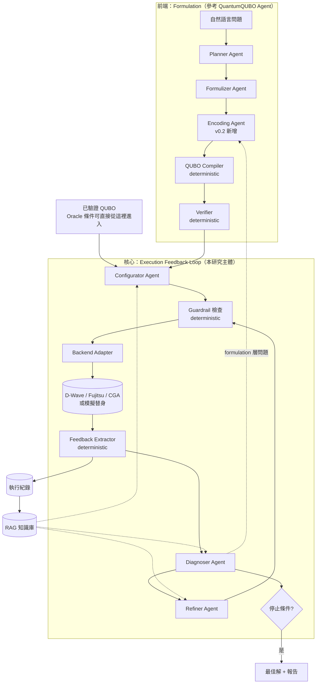

# 研究規格方案：Feedback-Driven Annealing Agent

> 版本：v0.2（草案）｜日期：2026-10-04
> v0.2 變更：新增 **Clarification Agent**（建模前與使用者確認題目）、**Encoding Agent**（逐條限制選擇 QUBO 編碼方式）、RQ4、編碼驗證工具與對應的路線圖階段；所有新增處標記「（v0.2 新增）」。v0.1 保留於版本紀錄。
> 本文件定義「做什麼、介面長什麼樣、怎麼驗證」，**刻意不規定實作細節**。凡標示「預設（可改）」的地方，都是起點而不是承諾。

---

## 0. 一句話定位

給一個最佳化問題（自然語言或已建好的 QUBO），系統自動產生 QUBO、設定 annealing backend、實際執行、分析結果，並根據**真實執行回饋**自動調整 penalty / scaling / solver 參數後重新求解，形成 closed-loop；支援 D-Wave、Fujitsu、CGA。

---

## 1. 研究問題與貢獻

### 研究問題

| 編號 | 問題 | 性質 |
|---|---|---|
| RQ1 | 通過數學驗證的 QUBO，在真實 annealer 上有多少比例表現不佳？失敗原因是什麼？ | Motivation / 特性分析 |
| RQ2 | 在固定 solver-call 預算下，Agent 的 closed-loop refinement 能否優於 rule-based heuristic 與 BO/Optuna？ | **核心** |
| RQ3 | 同一問題在不同 backend 的最佳設定差異多大？Agent 能否把某個 backend 的經驗轉移到另一個？ | 亮點 / 回答「為什麼需要 LLM」 |
| RQ4（v0.2 新增） | 依限制類型與 backend 特性，逐條限制自適應地選擇 QUBO 編碼方式（例如 slack vs. unbalanced、one-hot vs. domain-wall），能否改善硬體上的解品質？編碼選錯造成的問題有多少能被驗證抓到？ | 延伸 / formulation 層的 closed loop |

### 預期貢獻

1. **Hardware-in-the-loop 的 QUBO 工作流程**：把 formulation 接到真實 annealer，並讓執行結果回流修正（QuantumQUBO Agent 未做，且列為其 future work）。
2. **Semantic-preserving refinement**：定義 Agent 可調整的 action space，並由 deterministic code 保證調整後仍是原問題。
3. **Backend-agnostic 的 feedback 抽取**：三個 backend 的結果統一轉為同一組指標。
4. **Budget-matched 實證比較**：與 heuristic、BO 在相同 solver-call 預算下比較，並分析 LLM 在哪些失敗類型上有優勢。
5. **（v0.2 新增）Constraint-wise 編碼選擇**：由 Encoding Agent 逐條限制選擇編碼，QUBO 由已驗證的編碼函式庫以程式組裝；並以雙向驗證（違反 ⇒ penalty > 0；滿足 ⇒ 存在輔助變數使 penalty = 0）抓出「通過測資但編碼錯誤」的 QUBO。

### 與 QuantumQUBO Agent 的關係

- 前端（NL → QUBO）**參考並重新實作**其架構（MIT License，註明出處）。
- 不宣稱 NL → QUBO 為主要貢獻；主貢獻是執行回饋迴圈。
- 可直接把它當 baseline / 問題來源。

---

## 2. 設計原則（寫鬆不寫死）

1. **介面固定，實作可換**：每個元件只約定「輸入什麼、輸出什麼」。換模型、換 backend、換 prompt 不應改動其他元件。
2. **LLM 只做決策，不做計算**：轉換、執行、驗算、指標計算全部是 deterministic code。LLM 的輸出永遠先經過驗證才會被執行。
3. **所有東西都是設定檔**：模型、temperature、retry 次數、預算、停止條件、backend 清單都放在 config，不寫死在程式裡。
4. **Agent 數量可伸縮**：架構允許「多個 agent」或「一個 agent 扮演所有角色」切換，這本身就是 ablation。
5. **先模擬後實機**：每個 backend 都有一個本地模擬替身（如 simulated annealing），開發與大量統計在模擬上做，實機只做驗證。
6. **全程留紀錄**：每次 LLM 呼叫、每次 solver 執行、每次決策都寫入 log，可重播、可分析、可當 RAG 經驗。
7. **失敗要可降級**：任何一層失敗（LLM 輸出壞掉、backend 斷線），系統退回上一個可用設定，而不是整個崩潰。

---

## 3. 系統架構

**讀法**：上半部是前端（可選），中間是本研究的主體迴圈；虛線箭頭是「formulation 層的問題回傳給前端」與「RAG 支援決策」。實線方框中標示 deterministic 的都不是 LLM。

**（v0.2 新增）** Encoding Agent 位於 Formulizer 與 QUBO Compiler 之間：Formulizer 寫出帶類型的數學限制，Encoding Agent 逐條選擇編碼，Compiler 以已驗證的編碼函式庫組出 QUBO。迴圈中 Diagnoser 判定 `formulation_suspect` 或持續的 `precision_loss` 時，回到 Encoding Agent 換編碼，重新驗證後再進入迴圈。

---

## 4. 元件來源：沿用 / 替換 / 新增

| 元件 | 來源 | 處理方式 | 理由 |
|---|---|---|---|
| Planner Agent | QuantumQUBO Agent | 沿用概念，重寫 prompt | 結構化問題理解有效 |
| Judge Agent | QuantumQUBO Agent | 沿用（併入 Verifier 流程） | 一致性檢查有用 |
| Formulizer Agent | QuantumQUBO Agent | 沿用，**新增**：輸出需標記每個 penalty 對應哪條 constraint | 後面 Refiner 要用 |
| Coder Agent | QuantumQUBO Agent | **替換**為 QUBO Compiler（PyQUBO 或自寫符號展開） | 他們 79% 錯誤來自 LLM 寫程式 |
| Debugger Agent | QuantumQUBO Agent | 僅 NL 測資時使用 | 改用 deterministic generator 產生 instance |
| Test Runner | QuantumQUBO Agent | 沿用並**加強**：要求 argmin 集合**全部** feasible，不只是有交集 | 他們的檢查會放過有 infeasible 同能量解的 QUBO |
| Writer Agent | QuantumQUBO Agent | **不需要** | 與研究問題無關 |
| Instance generators（11 種） | QuantumQUBO Agent repo | 沿用並擴充可調規模 | 小 instance 用來驗證，大 instance 用來上機 |
| Configurator / Diagnoser / Refiner | — | **新增** | 本研究核心 |
| Encoding Agent（v0.2 新增） | — | **新增** | 複雜問題含多種限制，每種有多種編碼；編碼選錯時調參救不回來，甚至產生通過測資但錯誤的 QUBO |
| Backend Adapter、Feedback Extractor、Guardrail | — | **新增** | 本研究核心 |
| RAG 知識庫 | — | **新增** | 支援 cold-start 與跨 backend 經驗 |

---

## 5. Agent 角色定義

每個 agent 只約定職責與輸入/輸出的**內容**，格式以 JSON schema 管理（schema 放在設定，不寫死在程式碼）。

### 5.1 前端 agents（可選）

| Agent | 輸入 | 輸出 | 備註 |
|---|---|---|---|
| **Clarification Agent**（v0.2 新增） | 使用者的問題描述（可多輪） | 草稿 spec（變數、目標、硬/軟限制、所需資料、規模估計、假設）+ 依重要性排序的問題（標示必答） | 與使用者來回確認；**使用者明確確認前，後續步驟不得使用**。避免「給一個題目就直接做」造成誤解 |
| Planner | 自然語言問題 | 結構化 spec（變數、目標、限制、硬/軟限制） | 同 QuantumQUBO Agent |
| Formulizer | spec | 符號式 QUBO + 每條 penalty 的 constraint 標籤 + 初始 penalty 理由 | 不寫程式，只寫數學 |
| Judge | spec / formulation | pass/fail + 問題清單 | 可與 Formulizer 合併做 ablation |
| **Encoding Agent**（v0.2 新增） | 帶類型的限制清單、目標 backend 特性（精度、連接性）、RAG formulation 模式庫、（迴圈中）診斷結果 | 每條限制的編碼選擇 + 參數（如 slack 位數、unbalanced 係數）+ 理由 | 只做選擇；QUBO 由 Compiler 以編碼函式庫組裝並驗證 |

### 5.2 核心 agents

| Agent | 職責 | 輸入 | 輸出 |
|---|---|---|---|
| **Configurator** | 給出第一次執行的設定（cold-start） | QUBO 摘要（大小、密度、係數範圍、constraint 結構）、目標 backend、RAG 檢索結果 | 初始設定：penalty 倍率、scaling 策略、solver 參數 |
| **Diagnoser** | 判斷這一輪「哪裡出問題」 | Feedback 摘要、歷史紀錄、RAG | 診斷標籤 + 證據 + 建議的調整方向（例：「constraint C2 違反率 60%，penalty 可能太小」） |
| **Refiner** | 把診斷轉成具體調整 | 診斷結果、目前設定、合法 action 清單 | 下一輪設定（只能從合法 action 中選） |

**診斷標籤（初版，可擴充）**：
`penalty_too_weak`、`penalty_too_strong`、`precision_loss`（係數範圍過大）、`chain_break`（D-Wave）、`insufficient_sampling`、`schedule_mismatch`、`formulation_suspect`（回傳前端）、`converged`。

### 5.3 可伸縮配置（給 ablation 用）

- **Multi-agent**：Configurator / Diagnoser / Refiner 分開，各自的 context 只放需要的資訊。
- **Single-agent**：一個 agent 扮演全部角色，資訊與工具相同。
- **Backend-specialist**（選配）：每個 backend 一個專門 agent，加一個 coordinator。

切換方式只改設定檔，不改程式。

---

## 6. Deterministic 工具層

Agent 透過「工具」操作系統，工具一律是普通程式。

| 工具 | 功能 |
|---|---|
| `compile_qubo` | 符號式 formulation → 矩陣（v0.2：依 Encoding Agent 的選擇，呼叫編碼函式庫逐條組裝） |
| `encoding_library`（v0.2 新增） | 每種限制類型的候選編碼：等式平方懲罰；不等式的二進位 / 一元 slack、unbalanced penalization；one-hot 與 domain-wall；互斥、蘊含；整數變數的二進位 / 一元 / one-hot 編碼。每種附精確度標記（exact / approximate） |
| `verify_encoding`（v0.2 新增） | 雙向驗證每條限制：違反 ⇒ penalty > 0；滿足 ⇒ 存在輔助變數使 penalty = 0；近似編碼另以 argmin 檢查 |
| `qubo_to_ising` / `ising_to_qubo` | 格式轉換 |
| `verify_small` | 小 instance 暴力驗證（argmin 全部 feasible 且含真正最佳解） |
| `penalty_lower_bound` | 估算保證 feasible optimum 不變的 penalty 下界 |
| `scale_for_backend` | 依 backend 精度限制縮放係數，並驗證縮放前後 argmin 一致 |
| `check_params` | 檢查參數名稱存在、型別正確、在合法範圍 |
| `run` | 透過 Backend Adapter 執行 |
| `extract_feedback` | 從 sample set 計算統一指標 |
| `reference_solve` | 用 classical solver（如 Gurobi / CP-SAT / 長時間 SA）取得參考解 |

### Backend Adapter 介面（概念）

每個 backend 實作同一組能力，系統其他部分不知道底下是哪台機器：

- **describe()**：回報可調參數清單、合法範圍、係數精度限制、計費/額度單位
- **submit(qubo, params)**：執行並回傳原始結果
- **normalize(raw)**：轉成統一格式（samples、energies、時間、backend 專屬 metadata 另存）
- **simulate(qubo, params)**：本地模擬替身

新增 backend = 新增一個 adapter，其他不動。**CGA 的 adapter 要等確認其 API 後才能定義細節。**

---

## 7. RAG 知識庫

RAG 的用途是讓 LLM 的決策**有依據**，也是回答「為什麼需要 LLM」的關鍵：BO 換問題或換 backend 要從零開始，Agent 可以查資料與過去經驗。

### 7.1 知識來源（分四庫，可分別開關做 ablation）

| 知識庫 | 內容 | 給誰用 | 更新方式 |
|---|---|---|---|
| **Backend 文件庫** | D-Wave / Fujitsu / CGA 的參數說明、限制、官方建議 | Configurator、Refiner | 手動整理，版本化 |
| **Formulation 模式庫** | 常見 constraint 的 QUBO 寫法（one-hot、domain-wall、slack 編碼等）及其硬體特性 | Formulizer、Diagnoser | 手動整理 + 文獻 |
| **調參知識庫** | 文獻與經驗法則（penalty 設定方法、chain strength 經驗值等） | Diagnoser、Refiner | 手動整理 |
| **執行經驗庫** | 過去每次 run 的：問題特徵 → 設定 → 結果 → 診斷 → 調整是否有效 | 全部 | **自動寫入** |

### 7.2 檢索原則（預設，可改）

- 檢索 key 用**問題特徵**（問題類型、變數數、密度、constraint 種類、目標 backend），不用自然語言全文，降低 leakage。
- 每次檢索結果數量限制（預設 top-k = 3–5），避免塞爆 local model 的 context。
- Agent 引用的檢索內容要記錄在 log，事後可分析「RAG 有沒有幫上忙」。

### 7.3 防止污染（實驗設計關鍵）

- 執行經驗庫**依 train / test 切分**：測試問題的經驗不能出現在自己的檢索結果中。
- 跨 backend 轉移實驗（RQ3）時，明確控制「經驗庫裡有哪些 backend 的紀錄」。

---

## 8. Closed-loop Workflow

### 8.1 單一問題的流程

1. **準備**：取得 QUBO（前端產生或 oracle 給定）→ `verify_small` 通過才繼續。
2. **初始化**：Configurator 依問題特徵 + RAG 給出初始設定。
3. **檢查**：Guardrail 檢查設定合法性；不合法 → 退回並附錯誤訊息（最多重試 N 次，預設 N=2）。
4. **執行**：Backend Adapter 執行。
5. **回饋**：Feedback Extractor 計算指標並寫入 log。
6. **診斷**：Diagnoser 判斷問題；若為 `formulation_suspect` → 回前端（次數有上限）。
7. **調整**：Refiner 從合法 action 中選下一步。
8. **檢查停止條件** → 未停止則回到 3。
9. **輸出**：歷程中**以原問題指標**最佳的解（不是最後一輪的解）。

### 8.2 停止條件（任一成立即停；數值皆為預設，可改）

- 達到 solver-call 預算上限（預設 10 次）
- 連續 K 輪無改善（預設 K=3）
- 達到參考解的 gap 門檻
- Diagnoser 判定 `converged`

### 8.3 護欄（Guardrails，全部是程式，不靠 LLM 自律）

| 風險 | 防護 |
|---|---|
| 幻覺參數 / 不存在的參數 | `check_params` 對照 adapter 的 `describe()` |
| 參數超出範圍 | 自動截斷或拒絕，並回傳原因 |
| 改壞原問題語意 | objective 係數**禁止修改**；penalty 只能在 `penalty_lower_bound` 之上調整；scaling 必須通過 argmin 一致性檢查 |
| 無限迴圈 | 停止條件 + 重複設定偵測（同一設定不重跑） |
| 越調越差 | 永遠保留歷史最佳；可設定「退回最佳設定」為合法 action |
| LLM 輸出格式壞掉 | schema 驗證，失敗則重試，再失敗則採用 fallback 規則 |
| 燒光硬體額度 | 實機呼叫前檢查剩餘額度，超過預算拒絕執行 |

---

## 9. Feedback 與 Action Space

### 9.1 Feedback（分兩層）

| 層級 | 指標 | 來源 |
|---|---|---|
| **共通層**（三個 backend 一致） | feasibility rate、各 constraint 違反率、原問題 objective（最佳/平均）、與參考解的 gap、解的多樣性、執行時間 | 由我們的程式從 samples 計算 |
| **Backend 專屬層** | D-Wave：chain break 比例、embedding 資訊、timing 細項；Fujitsu / CGA：待確認 API 回傳內容 | backend 原始回傳 |

原則：**判斷「有沒有變好」只用共通層**；專屬層只拿來診斷與調整該 backend 的專屬參數。
注意：**energy 不能跨輪比較**（penalty 一改，能量地景就變了），只當診斷參考。

### 9.2 Action Space

| 類別 | 範例 | 跨 backend 可比？ | 風險 |
|---|---|---|---|
| Penalty 權重 | 個別 constraint 的 penalty 倍率 | 可 | 中（受下界保護） |
| 係數 scaling | 正規化方式、縮放倍率 | 可 | 低（受 argmin 檢查保護） |
| 取樣量 | sample / read 數 | 大致可 | 低 |
| Solver 參數 | annealing time、溫度排程、迭代數 | 不可 | 低 |
| Backend 專屬參數 | chain strength、embedding 重算等 | 不可 | 低 |
| Formulation 改寫 | encoding 方式、slack 設計 | 可 | **高**（必須回前端重新驗證；v0.2 起由 Encoding Agent 執行，經 `verify_encoding` 通過才可使用） |

**分階段開放**：第一階段只開放前五類；formulation 改寫列為後期擴充。

---

## 10. 實驗設計

### 10.1 Benchmark

- **主力問題**（有 constraint、penalty 敏感）：Knapsack、Graph Coloring、Set Cover、Facility Location / Scheduling（擇一）。
- **對照問題**：Max-Cut（無 constraint，用來確認系統在無 penalty 情境下不會變差）。
- **壓力測試**：TSP（規模小即超過硬體，觀察系統如何處理）。
- **Instance 來源**：沿用 repo 的 generator，產生多種規模；小規模（可暴力解）用於驗證，中大規模用於實驗。
- **Leakage 控制**：程序化產生 instance、改寫問題敘述；oracle QUBO 條件下 leakage 影響本來就小。

### 10.2 實驗條件

- **Oracle QUBO 條件**：直接給正確 QUBO，只測迴圈 → 回答 RQ2。
- **End-to-end 條件**：從自然語言開始 → 呈現完整系統效果；兩者差距 = formulation 錯誤造成的損失。

### 10.3 Baselines（全部使用相同 solver-call 預算）

1. Default：backend 預設參數 + 公式化 penalty，不調整
2. Rule-based heuristic：例如「違反哪條 constraint 就把該 penalty 加倍」
3. Random search
4. Bayesian Optimization（Optuna）
5. QuantumQUBO Agent 原始輸出直接上機（RQ1 用）

### 10.4 Ablations

- Multi-agent vs. single-agent（相同模型、工具、token 預算）
- 有 / 無 RAG（以及逐庫拿掉）
- 有 / 無 Diagnoser（Refiner 直接看原始 feedback）
- （v0.2 新增）固定編碼 vs. Encoding Agent 選擇的編碼；迴圈中允許 / 不允許換編碼
- Local model vs. 一個 frontier API 模型（作為能力上界參考）

### 10.5 指標

| 類別 | 指標 |
|---|---|
| 解品質 | feasibility rate、最佳 feasible objective、與參考解的 gap |
| 效率 | 達到目標品質所需的 solver call 數、wall-clock 時間 |
| 成本 | LLM token 數 / 推論時間、硬體使用量 |
| 穩定性 | 跨 seed 的變異、跨 instance 的勝率 |
| 行為分析 | 診斷正確率（對照人工標註或已知注入的錯誤）、無效 action 比例 |

### 10.6 統計與重現性（預設，可改）

- 模擬環境：每個條件 × 每個 instance 至少 10 個 seeds；實機視額度減少，但至少 3–5 次。
- LLM：temperature 固定為 0（另做一組非 0 的穩健性檢查）；prompt 版本化。
- 報告平均、標準差、以及統計檢定（如 Wilcoxon signed-rank）。
- 公開：config、prompt、log、instance 產生器 seed。

### 10.7 預算估算（開工前要先算）

> 總 solver calls ≈ 問題數 × instance 數 × 規模數 × 條件數（方法 + ablation）× seeds × 每次迴圈上限

依此估算決定：哪些實驗在模擬上做、哪些上實機。

---

## 11. 分階段路線圖

| 階段 | 內容 | 產出 | 完成判準 |
|---|---|---|---|
| **P0 基礎建設** | Backend Adapter（先 1 個 + 模擬替身）、Feedback Extractor、Guardrail、log | 可以手動跑一次完整迴圈 | 同一 QUBO 能在模擬與一台實機上跑並得到統一指標 |
| **P1 Motivation 實驗（RQ1）** | 拿 QuantumQUBO Agent 成功的 QUBO 放大上機 | 「數學正確 ≠ 硬體好解」的統計圖 | 有清楚的失敗比例與原因分類 |
| **P2 核心迴圈** | Configurator / Diagnoser / Refiner + baselines | RQ2 的主要結果 | Agent 與 baselines 的 budget-matched 比較完成 |
| **P2.5 編碼選擇（v0.2 新增）** | 編碼函式庫、`verify_encoding`、Encoding Agent、迴圈中換編碼 | RQ4 結果 | 至少一類問題（如 Knapsack：slack vs. unbalanced）證明換編碼能突破固定編碼的天花板 |
| **P3 RAG 與 ablation** | 四個知識庫、各 ablation | Ablation 表 | 能回答 multi-agent / RAG 各自貢獻 |
| **P4 跨 backend（RQ3）** | 加入第 2、3 個 backend，轉移實驗 | 跨 backend 結果 | 至少兩個 backend 完成比較 |
| **P5 前端整合** | NL → QUBO 前端接上迴圈 | End-to-end 結果 | Oracle vs. end-to-end 差距量化 |

**原則**：每一階段結束都有可寫進論文的結果；若時間不夠，P4、P5 可縮減而不影響核心貢獻。

---

## 12. 風險與待決事項

### 需要跟老師確認

- [ ] NL → QUBO 前端：是論文主要貢獻之一，還是系統前端即可？
- [ ] 主 backend 先選哪一個？（建議：回饋訊號最豐富、額度最充足者）
- [ ] 三個 backend 各自的使用額度與計費方式
- [x] CGA 是哪個系統？API 能設定哪些參數、回傳哪些資訊？（2026-10-06：Compal GPU Annealer 2.0 雲端服務，Socket.IO 介面；只能設定 `timeout`（秒），回傳 dimod SampleSet 與 run_time；每次呼叫另有約 60 秒排隊與前後處理。adapter 見 `qubo_auto/annealing/backends.py` 的 `CGABackend`）
- [ ] 目標投稿場域（影響實驗規模與篇幅）

### 技術風險

| 風險 | 影響 | 對策 |
|---|---|---|
| Local model 能力不足 | Agent 決策品質差 | 使用與 QuantumQUBO Agent repo 相同等級的 qwen3.6-35b-a3b（MoE，2×L40S 可跑）；加一組 frontier API 作上界 |
| Structured output 不穩定 | 迴圈中斷 | schema 驗證 + 重試 + fallback 規則；可用 constrained decoding |
| Agent 打不贏 BO | 核心結論變弱 | 分析在哪些情境（cold-start、少預算、跨 backend）有優勢；誠實報告也是貢獻 |
| 實機額度不足 | 統計顯著性不夠 | 大量實驗在模擬上做，實機做代表性驗證 |
| QuantumQUBO Agent 團隊做出類似工作 | 新穎性受威脅 | 盡快完成 P1 + P2，強調多 backend 與 budget-matched 比較 |
| 前端測資太小、最佳解「剛好」滿足較嚴格的編碼（v0.2 新增） | 錯誤的 QUBO 被判為正確（實例：Knapsack 的 ≤ 被編成 =） | `verify_encoding` 雙向驗證；測資需包含「最佳解不緊」的實例 |

---

## 13. 刻意保留彈性的地方

以下事項**故意不在本規格中定死**，實作時依實際狀況決定：

- 使用哪個 agent 框架（自寫、LangGraph、AutoGen 等）——只要能滿足第 5 節介面
- 具體 prompt 內容——版本化管理，隨實驗迭代
- 向量資料庫與 embedding 模型的選擇
- 診斷標籤的最終清單——初版見 5.2，依 P1 實驗結果擴充
- 所有數值預設（預算、重試次數、seeds、top-k）——放在 config，依試跑結果調整
- 第 2、3 個 backend 的接入順序

---

## 參考

- Mondal & Parvez, *QuantumQUBO Agent: Automating QUBO Formulation Generation from Natural Language*, ICML 2026 Workshop. [arXiv:2609.10629](https://arxiv.org/abs/2609.10629)
- 程式碼：[github.com/QuitttCat/QuantumQUBOAgent](https://github.com/QuitttCat/QuantumQUBOAgent)（MIT License）
